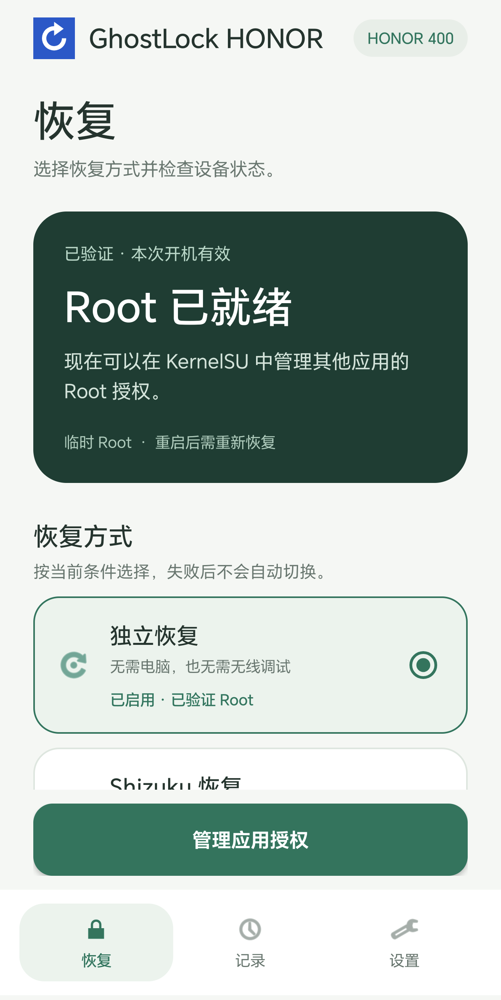
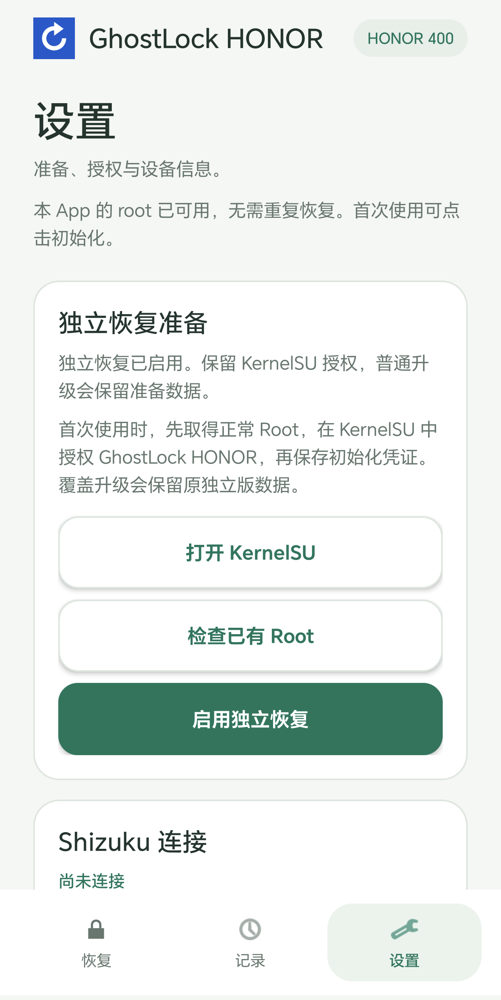

# GhostLock HONOR

简体中文 | [English](README.en.md)

[ghostlock-app](https://github.com/YuKongA/ghostlock-app) 的衍生 fork，面向 HONOR 400 的临时 Root 恢复。提供独立恢复和 Shizuku 恢复，以及初始化、操作记录和手动标记重置。

应用名称：`GhostLock HONOR`。包名：`dev.ghostlock.honor`。

基于上游提交 `437b3b257462e17d395cfd2cd8fb81536d6c6358`。原生源码位于 `native/`，保留同步停止修复；Android 界面及恢复协调逻辑位于 `app/`。来源和许可证见 [NOTICE](NOTICE)。

## 界面预览

| Root 状态与恢复方式 | 独立恢复准备 |
| --- | --- |
|  |  |

截图来自实机中文界面，已裁去系统状态栏和导航手势区域，不包含账号、设备唯一标识或操作日志。画面状态仅代表截图时的设备状态。

## 支持范围

- HONOR 400 海外版 / DNY-NX9
- `DNY-N39 10.0.0.213(C636E4R3P2)`
- 内核 `5.15.180-android13-8-00018-g9b2308ac0ad6-ab14563692`
- KernelSU 官方管理器 `v3.3.1`

### 地区版本差异与兼容限制

HONOR 400 在不同市场使用不同硬件配置，不能仅凭商品名称判断兼容性：

| 项目 | 中国大陆版 | 新加坡版 | 英国版 |
| --- | --- | --- | --- |
| 处理器 | 骁龙 7 Gen 4 | 骁龙 7 Gen 3 | 骁龙 7 Gen 3 |
| 电池典型容量 | 7200mAh | 6000mAh | 5300mAh |
| 有线快充 | 80W | 80W | 66W |

规格来源：[荣耀中国大陆发布说明](https://www.honor.com/cn/news/honor-400-launch/)、[新加坡规格页](https://www.honor.com/sg/phones/honor-400/spec/)、[新加坡产品页](https://www.honor.com/sg/phones/honor-400/)、[英国产品页](https://www.honor.com/uk/phones/honor-400/)。表中的地区仅用于规格对比，不代表本项目在这些市场版本上均已验证。

大陆版型号为 [DNN-AN00](https://developer.honor.com/cn/docs/game_center/guides/jieruzhinan/jixing)，海外版型号包括 [DNY-NX9](https://www.honor.com/uk/support/phones/honor-400/)。**目前仅验证了海外版 DNY-NX9，且仅限上列固件、完整内核版本与 KernelSU 管理器组合；不代表支持国行 DNN-AN00、其他地区版本、其他型号或其他固件及内核版本。** 即使同为 DNY-NX9，也不能推定所有地区固件兼容。上述海外型号本身不用于确定具体销售国家。

地区版本或系统升级可能改变内核、驱动和启动镜像；其他组合需单独适配与验证，不能直接沿用现有配置或镜像。

设备配置和固定哈希位于 `config/device.json`。其他固件不在支持范围内。Root 为临时状态，重启后失效；原生恢复可能失败或导致重启。本项目不刷写启动分区、不解锁 Bootloader，也不自动恢复。

## 构建

需要 Python 3.10+、Java 21、Android SDK Platform 35、Build Tools 和 Android NDK r29。

```sh
export ANDROID_SDK_ROOT=/path/to/android-sdk
export ANDROID_NDK_HOME=/path/to/android-ndk-r29
python3 tools/build.py --enable-recovery
```

构建会编译原生组件、校验依赖、运行主机测试并生成 `build/GhostLock-HONOR-1.0.0.apk`。默认使用本机生成的调试密钥；构建目录、密钥和安装包不进入 Git。省略 `--enable-recovery` 可构建仅检查版本；依赖已缓存时可添加 `--offline`。

自有签名：

```sh
python3 tools/build.py --enable-recovery \
  --keystore /path/to/release.keystore \
  --key-alias release \
  --password-file /path/to/password-file
```

原生主机测试：

```sh
make -C native native-host-tests
```

## 使用

1. 启动 Shizuku 的 shell 服务，连接并授权本应用，再检查和恢复 Root。
2. 在 KernelSU 允许本应用，点击“启用独立恢复”完成首次初始化。
3. 下次开机可选择独立恢复；失败并重启后，可以改用 Shizuku。
4. 需要时可在设置中“强制清除恢复标记”，无需 Root 或复核。初始化和授权保留，原始日志封存；清除不会自动执行恢复。

操作记录支持单条删除和全部清空。此应用使用独立包名，其他应用的初始化和授权不会自动迁入。

## 1.0.0 实机验证

2026-10-29，发布的 `dev.ghostlock.honor` 1.0.0 安装包在上述系统、内核和管理器版本下完成以下流程：

- 首次初始化成功，初始化凭证在重启后保留。
- 正常重启、确认 Root 已失效后，通过 Shizuku 恢复 Root 成功。本次 Shizuku 服务通过电脑 USB 调试启动。
- 再次正常重启、确认 Root 已失效后，通过独立恢复成功；此次未启动 Shizuku，无线调试关闭。USB 仅用于安装、操作界面和采集验证结果，恢复由 App 自身执行。
- 两种恢复均验证了实际 `su` 返回 UID 0；独立恢复也通过本 App 的 Root 授权验证。SELinux 保持 Enforcing，启动分区哈希未变，恢复期间未发生异常重启。

两种恢复方式在本轮各成功一次，不代表稳定性已充分验证，**尚不能确认此前的偶发重启问题已经解决**。Root 仍为临时状态，正常重启后需重新恢复。

发布说明见 [v1.0.0](docs/releases/v1.0.0.md)。

## 许可证

Apache-2.0。Shizuku API 的 MIT 许可证保存在 `licenses/`。KernelSU 加载器从已安装的官方管理器读取，不在仓库中分发。
